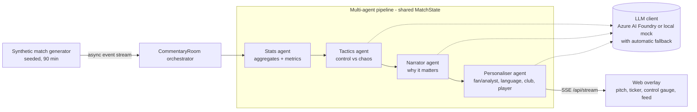

# Inside the Game – Multi-Agent Commentary Room

An AI commentary room that turns a **synthetic** live football event stream into explainable,
personalised match intelligence. Specialist agents (stats, tactics, narration, personalisation) share
a match "blackboard" and hand off to each other; a web overlay renders the result next to the action.

Built for the *Inside the Game: Developer Hackathon*. **Phase 1**: data generator, metrics,
agent layer with offline mock LLM, SSE API and overlay. Azure AI Foundry wiring is ready behind env vars.

## Architecture



The five challenge stages map to: **Ingest** (generator → stream), **Interpret** (Stats + metrics),
**Explain** (Tactics + Narrator), **Render** (SSE + overlay; every message is timed JSON),
**Personalise** (Personaliser: mode, language, favourite club, player focus).

## Run locally

```bash
python -m venv .venv && . .venv/bin/activate
pip install -e ".[dev]"
uvicorn insidethegame.server:app --reload
# open http://localhost:8000 , pick mode/language/club/player, press "Kick off"
pytest -q
```

Docker: `docker build -t inside-the-game . && docker run -p 8000:8000 inside-the-game`

### API
| Endpoint | Description |
|---|---|
| `GET /health` | liveness + active LLM provider |
| `GET /api/match?seed=7` | full synthetic match as JSON |
| `GET /api/stream?seed=7&speed=60&mode=fan&lang=es&club=harbour&player=H10` | SSE stream (`tick` events: `event`, `commentary[]`, `index`, `score`). `speed=60` → 1 match minute per second, `0` → as fast as possible |

### Configuration (env vars, see `.env.example`)
`ITG_LLM_PROVIDER=mock|azure`, `AZURE_OPENAI_ENDPOINT`, `AZURE_OPENAI_DEPLOYMENT`, `AZURE_OPENAI_API_VERSION`,
optional `AZURE_OPENAI_API_KEY` (if unset, managed identity via `DefaultAzureCredential`). No secrets are stored in the repo.
If the Azure call fails or times out (4 s), the agent transparently falls back to the deterministic mock.

## Synthetic data disclosure
* **All data is synthetic**, generated by `src/insidethegame/generator.py` from a random seed. No real match
  footage, data, or statistics are used or redistributed.
* **Teams, players and the venue are fictional** (e.g. "Harbour City Mariners", "Ironridge Rovers").
  No real club names, player names, or logos are used.
* Rates (≈1,000 passes, ≈30 shots, ≈3 goals, ≈25 fouls per match) are hand-tuned to look plausible. They are
  design targets, **not claims about real football statistics**. Assumptions are listed in the generator docstring.

## Metrics (`src/insidethegame/metrics.py`)
| Metric | Formula |
|---|---|
| xG-like shot value | `sigmoid(-1.1 - 0.11·distance + 1.6·goal_angle - 0.8·pressure - 0.6·header)` (illustrative, not trained) |
| Ball / pass speed | `distance / flight_time · 3.6` km/h |
| Pass difficulty | `0.5·min(dist/40,1) + 0.3·pressure + 0.2·clip(forward/30,0,1)` |
| Pass quality (0-100) | completed: `50 + 50·difficulty`; failed: `30·difficulty` |
| Control (per team, 5-min window) | `0.5·possession share + 0.3·pass completion + 0.2·final-third entry share` |
| Chaos (0-1) | `min(1, (turnovers + 0.5·pressures + fouls) / (window_min · 6))` |
| Momentum | `control_home − control_away` |

## Agents (`src/insidethegame/agents/`)
Each agent has a `name`, `instructions` (system prompt) and `handle(event, state)`, matching a Microsoft
Agent Framework executor. The orchestrator isolates failures per agent so one broken agent never stops the broadcast.

## Roadmap
Phase 2: Microsoft Agent Framework workflow + Azure AI Foundry agents, automatic recap, MCP tool server
for metrics, deployment to Azure Container Apps.

## License
MIT
