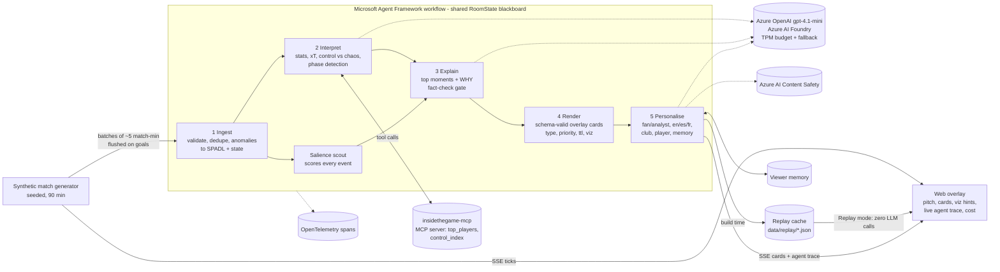

# Inside the Game: Multi-Agent Commentary Room

An AI commentary room that turns a **synthetic** live football event stream into explainable, personalised
overlay cards. **Five agents, one per challenge stage**, run as a **Microsoft Agent Framework workflow** on
**Azure OpenAI gpt-4.1-mini** (Azure AI Foundry). Every AI line is fact-checked and safety-checked before a viewer sees it.

Built for the *Inside the Game* developer hackathon. All clubs, players, crests, venues and matches are fictional.

**Live demo:** https://ca-insidethegame.kindisland-b212215e.francecentral.azurecontainerapps.io

## For judges: test it in 2 minutes
1. Open the live demo. **Replay** is selected by default: the AI commentary for the five showcase matches was
   precomputed by the same agents and checks, so the demo makes **zero live LLM calls**, starts instantly and
   gives every judge the same output.
2. Pick a match, a persona (**Fan / Neutral / Analyst**) and a language (**EN / ES / FR**). Optionally choose
   *My team* and a **★ favourite player**: their moments are boosted and highlighted in gold in the feed.
3. Press **▶ Kick off**. The pitch, score, timeline and feed share one match clock. Lines marked ✦ were written by
   the AI room and passed the checks. Ask the analyst desk a question at any time; open the full-time report at the end.
4. Switch the toggle to **Live AI** to watch the five agents run right now on Azure OpenAI (agent trace, tokens and
   cost update live).
5. Open **League** for the 16-club season (table, matchday slider, leaders, team pages) and **pre-match** comparisons.

## Microsoft technologies used
| Technology | Where |
|---|---|
| **Microsoft Agent Framework** | Five-agent workflow graph (fan-out / fan-in), one MAF `Agent` per role, MCP tool client, OpenTelemetry spans (`room/workflow.py`, `room/llm.py`) |
| **Azure OpenAI in Azure AI Foundry** (gpt-4.1-mini, GlobalStandard) | Explain, Interpret, Personalise agents, analyst desk, recap |
| **Microsoft Foundry Agent Service** | The analyst desk is also hosted as Foundry agent `itg-analyst-desk` in project `insidethegame` (`scripts/foundry_agent.py`, run log in `evals/foundry_agent_run.json`) |
| **Foundry evaluations** (`azure-ai-evaluation`) | Groundedness, Relevance and Fluency on the AI commentary (`scripts/run_evals.py`, results in `evals/`) |
| **Azure AI Content Safety** | Every AI-written line is screened (Hate, Sexual, Violence, SelfHarm) before it is cached or shown (`room/safety.py`) |
| **Model Context Protocol** | Interpret agent calls our MCP server (`insidethegame-mcp`) over stdio |
| **Azure Container Apps + Azure Container Registry** | Hosting (francecentral), secrets as Container Apps secrets |

## Architecture



| Stage | Agent | Deterministic core | LLM role (MAF `Agent`) |
|---|---|---|---|
| Ingest | `IngestAgent` | required fields, duplicate ids/fingerprints, time-travel, off-pitch clipping, unknown team, goal-without-shot; SPADL rows | – |
| Interpret | `InterpretAgent` | team/player stats, xT added, control-vs-chaos index, phases (siege, high press, chaos, control, balanced) | tactical read every 15 match-min, **calls the MCP server tools**; fact-checked |
| Explain | `SalienceScout` + `ExplainAgent` | salience score per event (xG, cards, xT, phase, late game); picks top 3 per batch | writes WHY in one batched JSON call; **every number must exist in the moment's facts**, otherwise rejected and replaced by a grounded template |
| Render | `RenderAgent` | overlay cards validated against `CARD_SCHEMA` (`GET /api/card-schema`): type, priority 1-5, ttl, title, text, viz hint (shot_marker, pass_arrow, control_gauge, badge) | – |
| Personalise | `PersonaliseAgent` | priority boosts for favourite club/player, fan filter, persistent `ViewerMemory` (fills missing prefs from last session) | rewrites all cards of a batch for mode + language in one call; re-fact-checked against the source card |

**Grounding (two gates).** (1) `factcheck.py`: every number must exist in the facts. (2) `semantic.py`: claims are
pulled out of the text with rules and checked against the match state: who leads xG/shots/control, which player
is credited, the minute, xG vs xT naming, half-time vs full-time labels, and the control index never being
called possession (EN/ES/FR). Contradictions trigger one batched repair call; anything still wrong falls back to
the grounded template. Fan-mode style rules (no decimals, speeds, distances or jargon, the scorer named on goals,
max 24 words) are enforced the same way. `ITG_LLM_VERIFY=1` adds an optional cheap LLM verifier pass (off by
default: in testing it was pedantic and added load).

**Throughput / quota.** Events are batched per `ITG_BATCH_S` (default 300 match-seconds, early flush on goals and
period ends), so a batch costs at most 3 LLM calls. `TokenBudget` reserves prompt + max_tokens per call against
both a 60 s window (`ITG_TPM_LIMIT`, default 9000 for a 10K TPM deployment) and a 10 s slice (`ITG_TPM_SLICE`); if a
call would not fit within 9 s it falls back to the deterministic text. Batches run on a background worker so the
pitch never stalls while the model thinks.

**Observability.** `ITG_OTEL=console|otlp` turns on Agent Framework's OpenTelemetry instrumentation (workflow,
executor, edge, chat and MCP spans) plus our `itg.<agent>` spans; the overlay shows the same trace live
(latency, tokens, MCP tool calls, fact-check results per agent).

## Run locally

```bash
python -m venv .venv && . .venv/bin/activate
pip install -e ".[dev]"
pip install -e ".[dev,azure,agents,mcp]"
uvicorn insidethegame.server:app --reload
# open http://localhost:8000 , pick mode/language/club/player, press "Kick off"
pytest -q
# optional, needs Azure OpenAI env vars:
python scripts/build_replay.py          # regenerate the replay cache
pip install azure-ai-evaluation && python scripts/run_evals.py   # Foundry evaluations -> evals/
python scripts/foundry_agent.py         # Foundry Agent Service analyst desk (needs `az login` + Azure AI User role)
```

Docker: `docker build -t inside-the-game . && docker run -p 8000:8000 inside-the-game`

### API
| Endpoint | Description |
|---|---|
| `GET /health` | liveness + active LLM provider |
| `GET /api/match?seed=7` | full synthetic match as JSON |
| `GET /api/stream?seed=7&speed=20&mode=fan&lang=es&club=harbour&player=H10&viewer=v1` | SSE: `tick` per raw event; `cards` per batch (`cards[]`, `trace[]`, `report`, `usage`, `phase`, `index`). `speed=60` → 1 match minute per second |
| `GET /api/card-schema` | JSON schema of overlay cards |

### Configuration (env vars, see `.env.example`)
`ITG_LLM_PROVIDER=mock|azure`, `AZURE_OPENAI_ENDPOINT`, `AZURE_OPENAI_DEPLOYMENT`, `AZURE_OPENAI_API_VERSION`,
optional `AZURE_OPENAI_API_KEY` (if unset, managed identity via `DefaultAzureCredential`). No secrets are stored in the repo.
If the Azure call fails, times out (4 s) or its line is rejected, the agent falls back to a human-written line in
the **viewer's chosen language** (`room/localise.py`): Spanish and French viewers never get English.
`ITG_CONTENT_SAFETY=1` screens AI lines with Azure AI Content Safety.
`ITG_ORCHESTRATOR=maf` (default) runs the five-agent Agent Framework workflow; `sequential` runs the same agents in a
plain loop (behaviour-identical, covered by a test). `ITG_USE_MCP=1` (default) gives the Interpret agent the real MCP
server over stdio, else in-process tools. The legacy four-agent pipeline is kept in `insidethegame.agents`.

## Synthetic data disclosure
* **All data is synthetic**, generated by `src/insidethegame/generator.py` from a random seed. No real match
  footage, data, or statistics are used or redistributed.
* **Teams, players and the venue are fictional** (e.g. "Harbour City Mariners", "Ironridge Rovers").
  No real club names, player names, or logos are used.
* Rates (≈1,000 passes, ≈30 shots, ≈3 goals, ≈25 fouls per match) are hand-tuned to look plausible. They are
  design targets, **not claims about real football statistics**. Assumptions are listed in the generator docstring.

## Metrics (`src/insidethegame/metrics.py`)
| Metric | Formula |
|---|---|
| xG-like shot value | `sigmoid(-1.1 - 0.11·distance + 1.6·goal_angle - 0.8·pressure - 0.6·header)` (illustrative, not trained) |
| Ball / pass speed | `distance / flight_time · 3.6` km/h |
| Pass difficulty | `0.5·min(dist/40,1) + 0.3·pressure + 0.2·clip(forward/30,0,1)` |
| Pass quality (0-100) | completed: `50 + 50·difficulty`; failed: `30·difficulty` |
| Control (per team, 5-min window) | `0.5·possession share + 0.3·pass completion + 0.2·final-third entry share` |
| Chaos (0-1) | `min(1, (turnovers + 0.5·pressures + fouls) / (window_min · 6))` |
| Momentum | `control_home − control_away` |

## Agents (`src/insidethegame/agents/`)
Each agent has a `name`, `instructions` (system prompt) and `handle(event, state)`, matching a Microsoft
Agent Framework executor. The orchestrator isolates failures per agent so one broken agent never stops the broadcast.

## Replay mode (default)
`python scripts/build_replay.py` runs the full five-agent room once per showcase match (seeds 7, 11, 23, 42, 58) x
persona (fan, neutral, analyst) x language (en, es, fr) = 45 runs, with the numbers, claims, roster, fan-style and
Content Safety checks on, and stores each batch keyed by the event that closed it in `src/insidethegame/data/replay/`.
`GET /api/stream?replay=true` replays the same event clock and releases each cached batch right after its event, so
the overlay behaves exactly like live. The favourite club/player is applied on top deterministically.
`GET /api/replay` lists the cached combinations; anything not cached (or `replay=false`) runs live.

## Fan mode
* One short line, no decimals, distances, speeds or jargon; the scorer is always named on goals.
* **Fair tone:** the prompt asks for warmth without bias, and the checker rejects mocking or insulting words and
  partisan "we/us/our" (EN/ES/FR) before a line is shown.
* **Favourite player focus:** pick a ★ player; their cards jump to top priority, get a ★ title and a gold highlight.
* **Language:** the chosen language is kept even when the model is unavailable (localised rules lines).

## Evaluation results (Microsoft Foundry evaluators)
`scripts/run_evals.py` samples 135 AI-written lines from the replay cache (3 per match x persona x language) and scores
them with the `azure-ai-evaluation` Groundedness, Relevance and Fluency evaluators (judge: gpt-4.1-mini, 1-5 scale,
pass >= 3). Context for groundedness = the card's facts, the only input the agents had. Per-line scores and judge
reasons: `evals/results.json`; summary: `evals/summary.json`.

| Metric | Mean (1-5) | Pass rate | Fan | Neutral | Analyst | EN | ES | FR |
|---|---|---|---|---|---|---|---|---|
| Groundedness | **4.72** | 92.6% | 4.84 | 4.44 | 4.87 | 4.84 | 4.49 | 4.82 |
| Relevance | **4.52** | 99.3% | 4.58 | 4.20 | 4.78 | 4.33 | 4.58 | 4.64 |
| Fluency | **3.29** | 100% | 3.11 | 3.16 | 3.60 | 3.24 | 3.29 | 3.33 |

* **Azure AI Content Safety:** 135/135 sampled lines at severity 0 in every category. While building the cache
  (1,333 cards), 5 AI rewrites were flagged at severity 2 and automatically replaced by the rules line.
* Building all 45 replay runs cost **$0.47** of gpt-4.1-mini; Fluency is modest by design (one short broadcast line).
* **Foundry Agent Service:** the hosted `itg-analyst-desk` agent answered 3/3 test questions on match 42 with zero
  issues from our numbers/claims/roster verifier (`evals/foundry_agent_run.json`).


## Responsible AI
* **Grounding:** the agents only see facts computed from the event stream; every number must exist in those facts,
  claims (who leads, who scored, minute, metric names) are checked against match state and the roster, with one repair
  round and a rules fallback. Titles are fixed, human-written strings per language.
* **Safety:** Azure AI Content Safety screens AI lines; anything at severity 2+ is replaced by the rules line.
* **Fairness:** fan persona is fair to both teams (enforced by checks, not only by prompt).
* **Transparency:** AI lines carry a ✦ marker, the agent trace (tokens, latency, rejections) is visible live, and the
  UI says replay vs live. Evaluation results are published in `evals/`.
* **Data and IP:** 100% synthetic data; no real clubs, players, leagues, footage or third-party brand assets.
* **Cost and quota:** token budget per minute, batching, replay cache; about one cent of AI per live match.
* **Limits:** the judge model for evaluations is the same small model; xG/xT here are illustrative, not trained on real data.

## License
MIT

## Analytics layer
* **SPADL export** (`spadl.py`): every match converts to the open SPADL action schema (pass/cross/shot/foul,
  success/fail/cards, foot/head, 105x68 m left-to-right frame), loadable by socceraction-style tooling.
* **Expected Threat** (`xt.py`): Markov value-iteration xT on a 16x12 grid, **fitted on our own 40 synthetic
  matches** (no third-party grid shipped). The Stats agent flags passes adding >= 0.04 xT.
* **MCP server** (`mcp_server.py`, `pip install -e ".[mcp]"`, run `insidethegame-mcp` or `--http`): tools
  `match_summary`, `spadl_actions`, `top_players`, `control_index`, `xt_grid` for any MCP client / Foundry agent.

## Credits & licences
Only ideas, schemas and published methods are reused; **no third-party data, code or brand assets are bundled**.

| Source | Licence | How we use it |
|---|---|---|
| SPADL / [socceraction](https://github.com/ML-KULeuven/socceraction) (Decroos et al., KDD 2019) | MIT | Re-implemented action schema vocabulary only |
| Expected Threat, [Karun Singh (2018)](https://karun.in/blog/expected-threat.html) | blog post, grid has no explicit licence | Method only; grid derived from our synthetic data |
| [Microsoft Agent Framework](https://github.com/microsoft/agent-framework) | MIT | Optional workflow orchestration dependency |
| [MCP Python SDK](https://github.com/modelcontextprotocol/python-sdk) | MIT | MCP server dependency |
| [kloppy](https://github.com/PySport/kloppy) (BSD-3), [mplsoccer](https://github.com/andrewRowlinson/mplsoccer), [floodlight](https://github.com/floodlight-sports/floodlight), [databallpy](https://github.com/Alek050/databallpy) (MIT) | see repos | Design references only, not dependencies |

Not used: StatsBomb open data (its terms require displaying the StatsBomb logo, which conflicts with the
no-third-party-brands rule), SoccerNet video (NDA), MatchTime/SoccerNet-Caption (no licence file).

## Deployment (Azure Container Apps, francecentral)
Live: https://ca-insidethegame.kindisland-b212215e.francecentral.azurecontainerapps.io

* The image is built **without Docker**: dependencies are installed for CPython 3.12 manylinux wheels into
  `app/site`, packed as a single layer and appended to `python:3.12-slim` with
  [crane](https://github.com/google/go-containerregistry), then pushed to ACR `acrinsidethegamealv` (Basic)
  using `az acr login --expose-token`. (`az acr build` is blocked on Azure for Students: `TasksOperationsNotAllowed`.)
* Container App `ca-insidethegame` in env `cae-insidethegame` (consumption / Express), 0.25 vCPU, 0.5 GiB, 1 replica.
* Express environments don't support managed identity, so the Azure OpenAI key and the ACR admin password are
  stored as Container Apps **secrets** (`secretref:`), never in plain env vars or the image.
* Stop: `az containerapp delete -n ca-insidethegame -g rg-insidethegame --yes`, then
  `az containerapp env delete -n cae-insidethegame -g rg-insidethegame --yes` and
  `az acr delete -n acrinsidethegamealv -g rg-insidethegame --yes`.

## Broadcast UI & analyst desk (v6)
* Hero landing, broadcast scoreboard, event timeline, animated 2D pitch (ball, pass trails, xG/xT markers), momentum chart
  (xT + xG per 5 min), typed commentary feed with fact-check badges, live agent pipeline (latency, tokens, MCP calls),
  cost & quality panel (cost so far, projected per match, LLM vs rules share, rejected rewrites).
* **Ask the analyst** (`POST /api/ask`): grounded Q&A over events up to the current minute (no spoilers); every LLM
  answer passes the numbers check, the semantic claim check and a roster check, with one repair round and a rules fallback.
* **Full-time report** (`GET /api/report?recap=true`, `format=md` to download): grounded LLM recap + team/player stats + key moments.
* Five showcase fixtures plus a 240-match season between 16 fictional clubs (`GET /api/matches`), personas Fan / Neutral / Analyst,
  EN/ES/FR, replay speed, favourite club/player, voice (browser speechSynthesis) and large-text/high-contrast mode.
* Screenshots: `docs/screenshots/` (`python scripts/screenshots.py <url>`).
