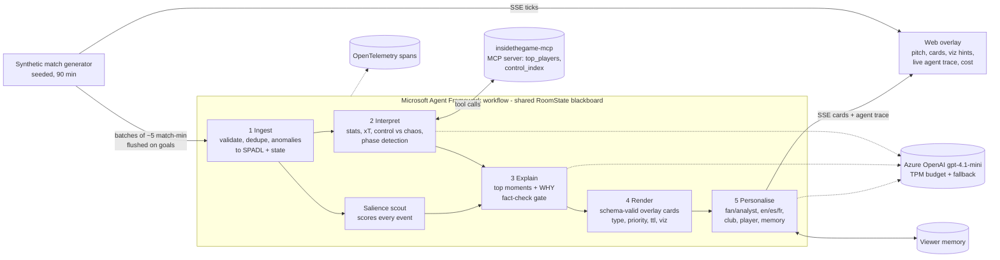

# Inside the Game – Multi-Agent Commentary Room

An AI commentary room that turns a **synthetic** live football event stream into explainable,
personalised overlay cards. **Five agents, one per challenge stage**, are orchestrated as a
**Microsoft Agent Framework workflow** (fan-out / fan-in graph) and reason with **Azure OpenAI gpt-4.1-mini**.

Built for the *Inside the Game: Developer Hackathon*.

## Architecture



| Stage | Agent | Deterministic core | LLM role (MAF `Agent`) |
|---|---|---|---|
| Ingest | `IngestAgent` | required fields, duplicate ids/fingerprints, time-travel, off-pitch clipping, unknown team, goal-without-shot; SPADL rows | – |
| Interpret | `InterpretAgent` | team/player stats, xT added, control-vs-chaos index, phases (siege, high press, chaos, control, balanced) | tactical read every 15 match-min, **calls the MCP server tools**; fact-checked |
| Explain | `SalienceScout` + `ExplainAgent` | salience score per event (xG, cards, xT, phase, late game); picks top 3 per batch | writes WHY in one batched JSON call; **every number must exist in the moment's facts**, otherwise rejected and replaced by a grounded template |
| Render | `RenderAgent` | overlay cards validated against `CARD_SCHEMA` (`GET /api/card-schema`): type, priority 1-5, ttl, title, text, viz hint (shot_marker, pass_arrow, control_gauge, badge) | – |
| Personalise | `PersonaliseAgent` | priority boosts for favourite club/player, fan filter, persistent `ViewerMemory` (fills missing prefs from last session) | rewrites all cards of a batch for mode + language in one call; re-fact-checked against the source card |

**Grounding (two gates).** (1) `factcheck.py`: every number must exist in the facts. (2) `semantic.py`: claims are
pulled out of the text with rules and checked against the match state: who leads xG/shots/control, which player
is credited, the minute, xG vs xT naming, half-time vs full-time labels, and the control index never being
called possession (EN/ES/FR). Contradictions trigger one batched repair call; anything still wrong falls back to
the grounded template. Fan-mode style rules (no decimals, speeds, distances or jargon, the scorer named on goals,
max 24 words) are enforced the same way. `ITG_LLM_VERIFY=1` adds an optional cheap LLM verifier pass (off by
default: in testing it was pedantic and added load).

**Throughput / quota.** Events are batched per `ITG_BATCH_S` (default 300 match-seconds, early flush on goals and
period ends), so a batch costs at most 3 LLM calls. `TokenBudget` reserves prompt + max_tokens per call against
both a 60 s window (`ITG_TPM_LIMIT`, default 9000 for a 10K TPM deployment) and a 10 s slice (`ITG_TPM_SLICE`); if a
call would not fit within 9 s it falls back to the deterministic text. Batches run on a background worker so the
pitch never stalls while the model thinks.

**Observability.** `ITG_OTEL=console|otlp` turns on Agent Framework's OpenTelemetry instrumentation (workflow,
executor, edge, chat and MCP spans) plus our `itg.<agent>` spans; the overlay shows the same trace live
(latency, tokens, MCP tool calls, fact-check results per agent).

## Run locally

```bash
python -m venv .venv && . .venv/bin/activate
pip install -e ".[dev]"
pip install -e ".[dev,azure,agents,mcp]"
uvicorn insidethegame.server:app --reload
# open http://localhost:8000 , pick mode/language/club/player, press "Kick off"
pytest -q
```

Docker: `docker build -t inside-the-game . && docker run -p 8000:8000 inside-the-game`

### API
| Endpoint | Description |
|---|---|
| `GET /health` | liveness + active LLM provider |
| `GET /api/match?seed=7` | full synthetic match as JSON |
| `GET /api/stream?seed=7&speed=20&mode=fan&lang=es&club=harbour&player=H10&viewer=v1` | SSE: `tick` per raw event; `cards` per batch (`cards[]`, `trace[]`, `report`, `usage`, `phase`, `index`). `speed=60` → 1 match minute per second |
| `GET /api/card-schema` | JSON schema of overlay cards |

### Configuration (env vars, see `.env.example`)
`ITG_LLM_PROVIDER=mock|azure`, `AZURE_OPENAI_ENDPOINT`, `AZURE_OPENAI_DEPLOYMENT`, `AZURE_OPENAI_API_VERSION`,
optional `AZURE_OPENAI_API_KEY` (if unset, managed identity via `DefaultAzureCredential`). No secrets are stored in the repo.
If the Azure call fails or times out (4 s), the agent falls back to the deterministic English template line
(non-English viewers see clean English until the model recovers, never a half-translated mix).
`ITG_ORCHESTRATOR=maf` (default) runs the five-agent Agent Framework workflow; `sequential` runs the same agents in a
plain loop (behaviour-identical, covered by a test). `ITG_USE_MCP=1` (default) gives the Interpret agent the real MCP
server over stdio, else in-process tools. The legacy four-agent pipeline is kept in `insidethegame.agents`.

## Synthetic data disclosure
* **All data is synthetic**, generated by `src/insidethegame/generator.py` from a random seed. No real match
  footage, data, or statistics are used or redistributed.
* **Teams, players and the venue are fictional** (e.g. "Harbour City Mariners", "Ironridge Rovers").
  No real club names, player names, or logos are used.
* Rates (≈1,000 passes, ≈30 shots, ≈3 goals, ≈25 fouls per match) are hand-tuned to look plausible. They are
  design targets, **not claims about real football statistics**. Assumptions are listed in the generator docstring.

## Metrics (`src/insidethegame/metrics.py`)
| Metric | Formula |
|---|---|
| xG-like shot value | `sigmoid(-1.1 - 0.11·distance + 1.6·goal_angle - 0.8·pressure - 0.6·header)` (illustrative, not trained) |
| Ball / pass speed | `distance / flight_time · 3.6` km/h |
| Pass difficulty | `0.5·min(dist/40,1) + 0.3·pressure + 0.2·clip(forward/30,0,1)` |
| Pass quality (0-100) | completed: `50 + 50·difficulty`; failed: `30·difficulty` |
| Control (per team, 5-min window) | `0.5·possession share + 0.3·pass completion + 0.2·final-third entry share` |
| Chaos (0-1) | `min(1, (turnovers + 0.5·pressures + fouls) / (window_min · 6))` |
| Momentum | `control_home − control_away` |

## Agents (`src/insidethegame/agents/`)
Each agent has a `name`, `instructions` (system prompt) and `handle(event, state)`, matching a Microsoft
Agent Framework executor. The orchestrator isolates failures per agent so one broken agent never stops the broadcast.

## Roadmap
Phase 2: Microsoft Agent Framework workflow + Azure AI Foundry agents, automatic recap, MCP tool server
for metrics, deployment to Azure Container Apps.

## License
MIT

## Analytics layer
* **SPADL export** (`spadl.py`): every match converts to the open SPADL action schema (pass/cross/shot/foul,
  success/fail/cards, foot/head, 105x68 m left-to-right frame), loadable by socceraction-style tooling.
* **Expected Threat** (`xt.py`): Markov value-iteration xT on a 16x12 grid, **fitted on our own 40 synthetic
  matches** (no third-party grid shipped). The Stats agent flags passes adding >= 0.04 xT.
* **MCP server** (`mcp_server.py`, `pip install -e ".[mcp]"`, run `insidethegame-mcp` or `--http`): tools
  `match_summary`, `spadl_actions`, `top_players`, `control_index`, `xt_grid` for any MCP client / Foundry agent.

## Credits & licences
Only ideas, schemas and published methods are reused; **no third-party data, code or brand assets are bundled**.

| Source | Licence | How we use it |
|---|---|---|
| SPADL / [socceraction](https://github.com/ML-KULeuven/socceraction) (Decroos et al., KDD 2019) | MIT | Re-implemented action schema vocabulary only |
| Expected Threat, [Karun Singh (2018)](https://karun.in/blog/expected-threat.html) | blog post, grid has no explicit licence | Method only; grid derived from our synthetic data |
| [Microsoft Agent Framework](https://github.com/microsoft/agent-framework) | MIT | Optional workflow orchestration dependency |
| [MCP Python SDK](https://github.com/modelcontextprotocol/python-sdk) | MIT | MCP server dependency |
| [kloppy](https://github.com/PySport/kloppy) (BSD-3), [mplsoccer](https://github.com/andrewRowlinson/mplsoccer), [floodlight](https://github.com/floodlight-sports/floodlight), [databallpy](https://github.com/Alek050/databallpy) (MIT) | see repos | Design references only, not dependencies |

Not used: StatsBomb open data (its terms require displaying the StatsBomb logo, which conflicts with the
no-third-party-brands rule), SoccerNet video (NDA), MatchTime/SoccerNet-Caption (no licence file).

## Deployment (Azure Container Apps, francecentral)
Live: https://ca-insidethegame.kindisland-b212215e.francecentral.azurecontainerapps.io

* The image is built **without Docker**: dependencies are installed for CPython 3.12 manylinux wheels into
  `app/site`, packed as a single layer and appended to `python:3.12-slim` with
  [crane](https://github.com/google/go-containerregistry), then pushed to ACR `acrinsidethegamealv` (Basic)
  using `az acr login --expose-token`. (`az acr build` is blocked on Azure for Students: `TasksOperationsNotAllowed`.)
* Container App `ca-insidethegame` in env `cae-insidethegame` (consumption / Express), 0.25 vCPU, 0.5 GiB, 1 replica.
* Express environments don't support managed identity, so the Azure OpenAI key and the ACR admin password are
  stored as Container Apps **secrets** (`secretref:`), never in plain env vars or the image.
* Stop: `az containerapp delete -n ca-insidethegame -g rg-insidethegame --yes`, then
  `az containerapp env delete -n cae-insidethegame -g rg-insidethegame --yes` and
  `az acr delete -n acrinsidethegamealv -g rg-insidethegame --yes`.

## Broadcast UI & analyst desk (v6)
* Hero landing, broadcast scoreboard, event timeline, animated 2D pitch (ball, pass trails, xG/xT markers), momentum chart
  (xT + xG per 5 min), typed commentary feed with fact-check badges, live agent pipeline (latency, tokens, MCP calls),
  cost & quality panel (cost so far, projected per match, LLM vs rules share, rejected rewrites).
* **Ask the analyst** (`POST /api/ask`): grounded Q&A over events up to the current minute (no spoilers); every LLM
  answer passes the numbers check, the semantic claim check and a roster check, with one repair round and a rules fallback.
* **Full-time report** (`GET /api/report?recap=true`, `format=md` to download): grounded LLM recap + team/player stats + key moments.
* Five selectable synthetic fixtures between six fictional clubs (`GET /api/matches`), personas Fan / Neutral / Analyst,
  EN/ES/FR, replay speed, favourite club/player, voice (browser speechSynthesis) and large-text/high-contrast mode.
* Screenshots: `docs/screenshots/` (`python scripts/screenshots.py <url>`).
